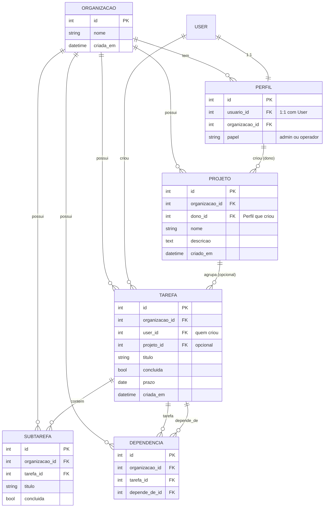

# P1DJANGO — Gestor de Tarefas multi-organização (P2)

Projeto da disciplina de **Laboratório de Programação Full Stack** (Engenharia de Software, Univassouras), feito em **Python/Django**.

Na **P1** o sistema era um gerenciador de tarefas com projetos, subtarefas e dependências entre tarefas. Na **P2** ele evolui para um **mini-SaaS**: várias organizações usam o mesmo sistema e o mesmo banco, mas cada uma enxerga **somente os próprios dados**. Ele também gera **métricas e um dashboard** e expõe tudo por uma **API REST** (Django REST Framework).

## Requisitos da P2 e onde estão

| Requisito do professor | Como foi atendido | Onde ver |
|---|---|---|
| **Multi-organização** | Model `Organizacao`, `Perfil` ligando o usuário à organização e FK de organização em todos os models. Toda consulta, formulário e endpoint filtra pela organização do usuário logado. | [Multi-organização](#multi-organização) e [Roteiro de testes](#roteiro-de-testes) |
| **Métricas** | 4 métricas calculadas pelo ORM (`aggregate`, `annotate`, `TruncMonth`): KPIs, ranking, série mensal e distribuição por situação. | `core/dashboard.py` e [Dashboard](#dashboard-e-métricas) |
| **Dashboard** | Tela com cartões, tabelas e gráficos (Chart.js), filtro por período validado, exportação em CSV e endpoint JSON. | `/dashboard/` e `/api/dashboard/` |

Além disso, a P2 traz **papéis** (administrador e operador), **API REST** de todos os recursos e **testes automatizados** (`python manage.py test`). O histórico das correções da P1 está em [`MELHORIAS_P1.md`](MELHORIAS_P1.md).

## Stack

- Python 3.12 ou superior e **Django 6**
- **Django REST Framework** (API com autenticação por sessão ou Basic)
- **SQLite** (arquivo `db.sqlite3`, criado pelo `migrate`)
- **Chart.js** (gráficos, carregado por CDN) e HTML/CSS simples nos templates

## Como rodar

### 1. Clonar e preparar o ambiente

```bash
git clone https://github.com/alvesssjean/P1DJANGO.git
cd P1DJANGO
```

Crie e ative o ambiente virtual:

| Sistema | Comandos |
|---|---|
| Linux / macOS | `python3 -m venv venv` e depois `source venv/bin/activate` |
| Windows (PowerShell) | `python -m venv venv` e depois `.\venv\Scripts\activate` |

Instale as dependências:

```bash
pip install -r requirements.txt
```

### 2. Criar o `.env`

O `.env` **não vem no repositório** (guarda a chave secreta), então este passo é obrigatório:

| Sistema | Comando |
|---|---|
| Linux / macOS | `cp .env.example .env` |
| Windows | `copy .env.example .env` |

Conteúdo padrão (já serve para avaliação):

```env
DJANGO_SECRET_KEY=troque-esta-chave-por-uma-longa-e-aleatoria
DJANGO_DEBUG=True
DJANGO_ALLOWED_HOSTS=127.0.0.1,localhost

DJANGO_SUPERUSER_USERNAME=admin
DJANGO_SUPERUSER_EMAIL=admin@exemplo.com
DJANGO_SUPERUSER_PASSWORD=admin123
```

> Mantenha `DJANGO_DEBUG=True` para rodar com `runserver`. Com `False`, o Django não serve os arquivos estáticos e a tela fica sem estilo e sem gráficos.

### 3. Criar o banco, o superusuário e subir o servidor

As migrations já estão no repositório, então **não precisa** rodar `makemigrations`.

```bash
python manage.py migrate
python manage.py createsuperuser --noinput
python manage.py runserver
```

O `createsuperuser --noinput` usa as credenciais do `.env`: usuário **`admin`** e senha **`admin123`**.

Abra http://127.0.0.1:8000/. Para recomeçar do zero, apague o arquivo `db.sqlite3` e repita este passo.

## Primeiro acesso: como entrar

O sistema é multi-organização, então **todo usuário precisa pertencer a uma organização** (ter um `Perfil`). Há três caminhos:

| Caminho | Como fazer | O que acontece |
|---|---|---|
| **A. Cadastrar uma conta nova** (recomendado) | Abra http://127.0.0.1:8000/register/, escolha usuário e senha. | O sistema cria uma organização própria (**"Organização de &lt;usuário&gt;"**) e a conta vira **Administrador** dela. Você já entra logado em `/`. |
| **B. Entrar com o superusuário** | Abra http://127.0.0.1:8000/login/ e use `admin` / `admin123`. | No primeiro acesso, o superusuário recebe o papel de **Administrador** na **"Organização padrão"**. Ele também acessa `/admin/`. |
| **C. Usuário criado pelo `/admin/`** | Em `/admin/` > *Users* > *Add user*; depois *Perfis* > *Add* e escolha o usuário, a organização e o papel. | Sem o **Perfil**, o usuário recebe **403 Forbidden** ao abrir qualquer tela do sistema. Esse é o comportamento esperado do isolamento. |

> **Dica para ver o isolamento:** use duas janelas anônimas (ou dois navegadores) para ficar logado com dois usuários ao mesmo tempo.

## Mapa de URLs

Base: `http://127.0.0.1:8000`

### Telas do site

| URL | O que é | Quem acessa |
|---|---|---|
| `/register/` | Cadastro. Cria usuário, organização própria e Perfil de administrador. | Qualquer pessoa |
| `/login/` | Login. | Qualquer pessoa |
| `/` | Tela principal: formulários de projeto, tarefa e dependência, e a lista de tarefas da organização. Aceita `?q=texto` (busca) e `?status=pendentes` ou `?status=concluidas`. | Logado, com Perfil |
| `/dashboard/` | Dashboard da organização. Aceita `?inicio=AAAA-MM-DD&fim=AAAA-MM-DD`. | Logado, com Perfil |
| `/dashboard/exportar/` | Download do relatório `tarefas.csv`, com o mesmo filtro de período. | **Só administrador** |
| `/tarefa/<id>/concluir` e `/tarefa/<id>/deletar` | Ações dos botões da lista (só aceitam `POST`). | Logado, com Perfil |
| `/logout/` | Sair (botão **Sair (Logout)** no menu; usa `POST`). | Logado |
| `/admin/` | Painel administrativo do Django. | Superusuário |

### API REST

| URL | Recurso | Métodos |
|---|---|---|
| `/api/tarefas/` e `/api/tarefas/<id>/` | Tarefas | GET, POST / GET, PUT, PATCH, DELETE |
| `/api/projetos/` e `/api/projetos/<id>/` | Projetos | GET, POST / GET, PUT, PATCH, DELETE |
| `/api/subtarefas/` e `/api/subtarefas/<id>/` | Subtarefas | GET, POST / GET, PUT, PATCH, DELETE |
| `/api/dependencias/` e `/api/dependencias/<id>/` | Dependências | GET, POST / GET, DELETE |
| `/api/dashboard/` | Métricas (mesmos números da tela) | GET |
| `/api-auth/login/` | Login da Browsable API (a página navegável da API) | — |

## Perfis e papéis

| Papel | O que acessa |
|---|---|
| **Visitante** (sem login) | Só `/login/` e `/register/`. Qualquer outra URL do sistema redireciona para o login (telas) ou responde 403 (API). |
| **Operador** | Tarefas, projetos, subtarefas e dependências da organização. No dashboard vê cartões, ranking e situação das tarefas, **sem** a série mensal e **sem** exportar CSV. |
| **Administrador** | Tudo do operador, mais a série mensal do dashboard e a exportação em CSV (tela e API). |
| **Superusuário** | Administrador da "Organização padrão" e acesso ao `/admin/`. |
| **Sem Perfil** | 403 em todas as telas e endpoints. |

Hoje o papel só diferencia o dashboard. Dentro da organização, administrador e operador enxergam as mesmas tarefas e projetos.

## Roteiro de testes

Siga na ordem. Todas as URLs são relativas a `http://127.0.0.1:8000`.

### Preparação (uns 10 minutos)

1. Em `/register/` crie três contas: **ana**, **beto** e **carla** (cada uma ganha uma organização própria).
2. Crie o **otavio** pelo `/admin/` (entre com `admin`/`admin123`): *Users* > *Add user* > depois *Perfis* > *Add*, com usuário **otavio**, organização **"Organização de ana"** e papel **Operador**.
3. **Dados da Ana** (em `/`): projeto **Alfa**; tarefa **A1 concluída** no projeto Alfa, e clique em *Marcar como Concluída*; tarefa **A2 atrasada**, sem projeto, com prazo de **ontem**; tarefa **A3 no prazo**, sem projeto e sem prazo.
4. **Dados do Beto** (em `/`): projeto **Beta** e 5 tarefas (**B1** a **B5**), sendo 2 delas no projeto Beta.
5. Com a Ana, abra `/api/tarefas/` e anote o **id** da A1 (campo `id`). Em `/api/projetos/` anote o id do **Alfa**. Em `/api/subtarefas/` crie uma subtarefa na A1 (`{"tarefa": ID_DA_A1, "titulo": "Sub da A1"}`).

Os números esperados do dashboard abaixo valem para estes dados. Cada cenário tem um **Resultado obtido** em branco para você preencher.

### A. Multi-organização

| Cenário | Resultado esperado | Resultado obtido |
|---|---|---|
| **T01.** Ana abre `/`. | Vê só A1, A2 e A3 e o projeto Alfa. O menu mostra "Organização de ana · ana (Administrador)". | |
| **T02.** Beto abre `/`. | Vê só B1 a B5 e o projeto Beta. Nada da Ana. | |
| **T03.** Beto abre os seletores **Projeto** (Nova Tarefa) e **Depende de** (Nova Dependência). | **Projeto** lista só "Beta". **Depende de** lista só tarefas do Beto. | |
| **T04.** Beto abre `/api/tarefas/ID_DA_A1/`. | 404 "Não encontrado." (igual a um id que não existe). | |
| **T05.** Beto abre `/api/projetos/ID_DO_ALFA/` e `/api/subtarefas/`. | O primeiro dá 404; o segundo lista `[]`. | |
| **T06.** Na Browsable API, Beto faz **DELETE** em `/api/tarefas/ID_DA_A1/`. | 404 e a A1 continua na lista da Ana. | |
| **T07.** Beto cria em `/api/tarefas/` o corpo `{"titulo": "Invasora", "projeto": ID_DO_ALFA}`. | 400: o projeto de outra organização não é aceito. | |
| **T08.** Beto cria em `/api/dependencias/` o corpo `{"tarefa": ID_DE_UMA_TAREFA_DELE, "depende_de": ID_DA_A1}`. | 400 ("Pk inválido"). | |
| **T09.** Beto cria em `/api/tarefas/` o corpo `{"titulo": "Do Beto", "organizacao": ID_DE_OUTRA_ORG}`. | 201; o campo `organizacao` é ignorado e a tarefa aparece só no `/` do Beto. | |
| **T10.** Otavio (operador da organização da Ana) abre `/`. | Vê A1, A2 e A3: a organização é compartilhada. | |
| **T11.** Entre com um usuário criado no `/admin/` **sem Perfil** e abra `/`. | Página **403 Forbidden**. | |
| **T12.** Entre em `/login/` com `admin`/`admin123` e abra `/`. | Abre normalmente, com "Organização padrão · admin (Administrador)", e sem nenhuma tarefa da Ana nem do Beto. | |
| **T13.** Sem login, abra `/` e `/dashboard/`. | Redireciona para `/login/?next=...`. | |
| **T14.** Sem login, abra `/api/tarefas/`. | 403 "As credenciais de autenticação não foram fornecidas." | |

### B. Regras de negócio (use a conta da Carla)

| Cenário | Resultado esperado | Resultado obtido |
|---|---|---|
| **T15.** Carla cria as tarefas **X** e **Y** e, em *Nova Dependência*, "Y depende de X". Clique em *Marcar como Concluída* na **Y**. | Mensagem vermelha "Não é possível concluir esta tarefa: existem dependências ainda não concluídas." A Y continua pendente e aparece "Bloqueada por: X". | |
| **T16.** Conclua a **X** e depois a **Y**. | As duas concluem. | |
| **T17.** Crie a dependência "X depende de Y". | Recusada: "Essa dependência criaria um ciclo." | |
| **T18.** Crie o projeto **P** e uma tarefa nesse projeto com prazo de **ontem**. | Erro no campo prazo: "O prazo não pode ser anterior à criação do projeto". | |
| **T19.** Carla cria as tarefas **Z** e **W** e a dependência "Z depende de W" (a W continua pendente). Depois, em `/api/tarefas/ID_DA_Z/`, envie `PATCH` com `{"concluida": true}`. | 400: a API aplica a mesma regra do site. | |
| **T20.** Em `/api/tarefas/`, crie `{"titulo": "ab"}`. | 400 "O título deve ter pelo menos 3 caracteres." | |
| **T21.** Em `/?q=X` e depois em `/?status=concluidas`. | A busca mostra só tarefas com "X" no título; o filtro mostra só as concluídas. | |

### C. Dashboard e métricas (use Ana, Beto e Otavio)

| Cenário | Resultado esperado | Resultado obtido |
|---|---|---|
| **T22.** Ana abre `/dashboard/`. | Cartões: **Tarefas 3**, **Pendentes 2**, **Atrasadas 1**, **Concluídas 1**, **Responsáveis ativos 1**. | |
| **T23.** Ana confere o restante da tela. | "Projetos com mais tarefas": só **Alfa (1)**. "Tarefas por situação": Concluídas 1, Pendentes no prazo 1, Atrasadas 1. Aparecem o gráfico de barras por mês (uma barra com 3) e a rosca de situação. | |
| **T24.** Beto abre `/dashboard/`. | **Tarefas 5**, só o projeto **Beta (2)** no ranking. Nenhum número da Ana. | |
| **T25.** Ana abre `/dashboard/?inicio=2099-01-01`. | Tudo zerado, com "Sem dados no período."; sem gráfico quebrado e sem erro. | |
| **T26.** Ana abre `/dashboard/?inicio=abc`. | Página abre normalmente (200), com mensagem de erro de data, e os totais completos (3). | |
| **T27.** Ana abre `/dashboard/?inicio=2026-12-31&fim=2026-01-01`. | Mensagem "A data inicial não pode ser posterior à final."; sem erro 500. | |
| **T28.** Ana filtra com os campos de data: início **hoje** (e depois, fim **ontem**). | Início hoje: Tarefas 3. Fim ontem: Tarefas 0. | |
| **T29.** Ana clica em **Exportar CSV**. | Baixa `tarefas.csv` com o cabeçalho `Título;Projeto;Criada por;Criada em;Prazo;Situação` e 3 linhas (A1 "Concluída", A2 "Atrasada", A3 "Pendente"). Nenhuma tarefa de outro usuário. | |
| **T30.** Confira à mão: número de linhas do CSV (sem o cabeçalho) e o cartão **Tarefas**. | Os dois valem 3. | |
| **T31.** Carla cria uma tarefa chamada `=1+1` e, como administradora, exporta o CSV. | A célula aparece como `'=1+1` (o apóstrofo impede o Excel de calcular uma fórmula). | |
| **T32.** Otavio (operador) abre `/dashboard/`. | Vê cartões, ranking e situação; **não** vê o gráfico mensal nem o link *Exportar CSV*. | |
| **T33.** Otavio abre `/dashboard/exportar/` digitando a URL. | 403. | |
| **T34.** Ana abre `/api/dashboard/`. | JSON com `kpis` (`total` 3), `ranking`, `distribuicao` e `por_mes`. | |
| **T35.** Otavio abre `/api/dashboard/`. | Mesmo JSON, **sem** `por_mes`. | |
| **T36.** Beto abre `/api/dashboard/`. | `kpis.total` igual a 5. | |
| **T37.** Ana abre `/api/dashboard/?inicio=abc`. | 400 com o erro do campo `inicio`. | |
| **T38.** Sem login, abra `/dashboard/exportar/`. | Redireciona para `/login/`. | |

### Testes automatizados

```bash
python manage.py test
```

Cobrem o isolamento entre organizações (telas e API), as regras de negócio, as métricas, o filtro de período, os papéis, o CSV, a API do dashboard e a ausência de N+1 nas consultas.

## Modelo de dados



`Projeto`, `Tarefa`, `Subtarefa`, `Dependencia` e `Perfil` herdam da base abstrata `DaOrganizacao`, que traz a FK `organizacao`. `Organizacao` e `User` são a raiz do isolamento e não herdam. A posse dos dados é da organização; `Tarefa.user` e `Projeto.dono` significam apenas "quem criou".

### Regras de negócio

As regras ficam nos **models** (método `clean()` chamado por `full_clean()` no `save()`), então valem igualmente para as telas, a API e o `/admin/`.

- **Bloqueio por dependência:** uma tarefa não pode ser concluída enquanto houver dependência pendente.
- **Sem ciclos:** uma tarefa não depende dela mesma nem, direta ou indiretamente, de uma tarefa que dependa dela.
- **Prazo coerente:** o prazo não pode ser anterior à data de criação do projeto da tarefa.
- **Mesma organização:** a tarefa e o projeto, a subtarefa e a tarefa, e as duas tarefas de uma dependência precisam ser da mesma organização.
- **Título:** a API exige pelo menos 3 caracteres.

## Multi-organização

O isolamento usa a estratégia de **coluna discriminadora**: todos os dados ficam no mesmo banco e cada linha carrega a FK `organizacao`. As regras de ouro, aplicadas em toda tela e endpoint:

1. **Toda consulta parte da organização do usuário logado.** O ponto único é `org_atual(request)` em `core/tenancy.py`. Não há `Model.objects.all()` nem busca só por `pk`.
2. **`get_object_or_404` sempre leva a organização junto.** Registro de outra organização responde **404**, igual a um id que não existe, sem revelar que ele existe.
3. **A organização vem do usuário logado, nunca da URL nem do formulário.** Os formulários e serializers não têm o campo `organizacao`; na API, um `organizacao` enviado no corpo é ignorado.
4. **Selects de formulário filtrados**: os campos de projeto e de tarefa mostram só opções da organização.
5. **Usuário sem Perfil** recebe 403. O superusuário recebe um Perfil de administrador na "Organização padrão" no primeiro acesso.

| Tela ou endpoint | Como o isolamento é aplicado |
|---|---|
| `/` (lista, busca e filtro) | `Tarefa.objects.filter(organizacao=org)`, com `select_related` e `Prefetch` (sem N+1). |
| `/` (criar projeto, tarefa e dependência) | A view preenche `organizacao` (e o criador) depois de `save(commit=False)`; os seletores são filtrados pela organização. |
| `/tarefa/<id>/concluir` e `/deletar` | `get_object_or_404(Tarefa, pk=pk, organizacao=org)`. |
| `/dashboard/` e `/dashboard/exportar/` | Toda métrica parte de `Tarefa.objects.filter(organizacao=org)` (`base_queryset`). |
| `/api/tarefas/`, `/api/projetos/`, `/api/subtarefas/`, `/api/dependencias/` | `get_queryset` filtra por organização; os campos de relação do serializer só aceitam objetos da organização; o 404 vale para registro alheio. |
| `/api/dashboard/` | Mesmas funções de métricas da tela. |

## API REST

A API usa a **mesma sessão do login do site** (para a Browsable API) ou **Basic Auth** (para o `curl`), e cada pessoa só enxerga os dados da própria organização.

### Códigos de status

| Código | Quando |
|---|---|
| 200 | Leitura ou atualização com sucesso |
| 201 | Criação com sucesso |
| 204 | Exclusão com sucesso (sem corpo) |
| 400 | Dados inválidos (o corpo traz o erro de cada campo ou do model) ou período inválido no dashboard |
| 403 | Sem login, ou logado sem Perfil |
| 404 | Registro inexistente **ou de outra organização** |
| 405 | Método não permitido |

Sem login a resposta é `403` (e não `401`), porque a autenticação por sessão não envia o cabeçalho `WWW-Authenticate`.

### Usando a Browsable API (mais fácil)

1. Abra `/api-auth/login/` e entre.
2. Abra `/api/tarefas/`, `/api/projetos/` etc. No rodapé da página há formulários para criar (POST), e nas páginas de detalhe há botões para editar (PUT/PATCH) e apagar (DELETE).

### Usando `curl` (Basic Auth)

No PowerShell use `curl.exe` (o `curl` é um alias de outro comando) e escreva o JSON com aspas escapadas, ou prefira a Browsable API.

```bash
BASE=http://127.0.0.1:8000

# Criar uma tarefa -> 201
curl -s -u ana:SUA_SENHA -X POST $BASE/api/tarefas/ \
  -H "Content-Type: application/json" -d '{"titulo": "Estudar Django"}'
# {"id": 1, "titulo": "Estudar Django", "concluida": false, "prazo": null, "projeto": null}

# Listar (só da organização da Ana) -> 200
curl -s -u ana:SUA_SENHA $BASE/api/tarefas/

# Concluir -> 200 (ou 400 se houver dependência pendente)
curl -s -u ana:SUA_SENHA -X PATCH $BASE/api/tarefas/1/ \
  -H "Content-Type: application/json" -d '{"concluida": true}'

# Título curto -> 400
curl -s -u ana:SUA_SENHA -X POST $BASE/api/tarefas/ \
  -H "Content-Type: application/json" -d '{"titulo": "ab"}'
# {"titulo": ["O título deve ter pelo menos 3 caracteres."]}

# Tarefa de outra organização -> 404
curl -s -i -u beto:SUA_SENHA $BASE/api/tarefas/1/

# Sem login -> 403
curl -s -i $BASE/api/tarefas/
```

Corpos de criação dos demais recursos:

| Recurso | Corpo |
|---|---|
| Projeto | `{"nome": "Alfa", "descricao": "opcional"}` |
| Subtarefa | `{"tarefa": 1, "titulo": "Sub da tarefa 1"}` |
| Dependência | `{"tarefa": 2, "depende_de": 1}` (a tarefa 2 passa a depender da 1) |
| Tarefa com projeto e prazo | `{"titulo": "Revisar", "projeto": 1, "prazo": "2026-12-31"}` |

## Dashboard e métricas

Tela da organização em `/dashboard/`. Cada métrica responde a uma pergunta que o dono do negócio faz toda semana:

| Pergunta | Tipo | Métrica na tela |
|---|---|---|
| Quantas tarefas existem, quantas estão pendentes, atrasadas e concluídas? | Total (KPI) | Cartões: Tarefas, Pendentes, Atrasadas, Concluídas e Responsáveis ativos |
| Quais projetos concentram mais tarefas? | Ranking | Top 5 projetos por quantidade de tarefas |
| Como evolui a criação de tarefas? | Série no tempo | Gráfico de barras com as tarefas criadas por mês (**só administrador**) |
| Qual a proporção entre concluídas, no prazo e atrasadas? | Distribuição | Rosca e tabela "Tarefas por situação" |

### Regras

- **Isolamento:** toda métrica parte de `Tarefa.objects.filter(organizacao=org)`. O dashboard de uma organização nunca mostra números de outra.
- **Atrasada** é a tarefa pendente com prazo anterior a hoje. "Hoje" vale para a data atual, independentemente do período escolhido.
- **Responsáveis ativos** conta os usuários distintos que criaram tarefas.
- **Papéis:** o administrador vê a série mensal e exporta o CSV; o operador vê cartões, ranking e situação.

### Filtro por período

`?inicio=AAAA-MM-DD&fim=AAAA-MM-DD`, aplicado sobre a **data de criação** da tarefa. O dia final é incluído. Pode informar só um dos limites.

| Situação | Resultado |
|---|---|
| Sem parâmetros | Todas as tarefas da organização |
| Data inválida (`?inicio=abc`) | Mensagem de erro na tela, **sem erro 500**, e os totais completos |
| `inicio` depois de `fim` | Mensagem "A data inicial não pode ser posterior à final." |
| Na API, qualquer período inválido | 400 com o erro do campo |

### Exportação em CSV

O link **Exportar CSV** (só para administrador) baixa `/dashboard/exportar/?inicio=...&fim=...`, com a **mesma base filtrada** do dashboard. Colunas: Título, Projeto, Criada por, Criada em, Prazo e Situação. O arquivo usa `;` como separador e UTF-8 com BOM, para abrir direto no Excel em português. Textos que começam com `=`, `+`, `-` ou `@` recebem um apóstrofo na frente, para o Excel não os interpretar como fórmula. Um período inválido responde 400, para ninguém exportar sem filtro achando que filtrou.

### API do dashboard

`GET /api/dashboard/` devolve as mesmas métricas em JSON, com o mesmo período e a mesma regra de papéis:

```json
{
  "kpis": {"total": 3, "concluidas": 1, "pendentes": 2, "atrasadas": 1, "responsaveis": 1},
  "ranking": [{"projeto_id": 1, "projeto__nome": "Alfa", "total": 1, "pendentes": 0}],
  "distribuicao": [
    {"status": "Concluídas", "total": 1},
    {"status": "Pendentes no prazo", "total": 1},
    {"status": "Atrasadas", "total": 1}
  ],
  "por_mes": [{"mes": "11/2026", "total": 3}]
}
```

O campo `por_mes` só vem para administradores. Os valores acima são de ilustração.

### Desempenho

- As métricas vêm de poucas consultas (`aggregate`, `values` + `annotate`, `Count` com `filter`), sem acessar relações dentro de loop.
- A lista de `/` usa `select_related('projeto')` e `Prefetch` das dependências abertas; o CSV usa `select_related`. Os testes `DesempenhoTests` falham se o número de consultas voltar a crescer com os dados (N+1).
- Há um índice composto em `Tarefa(organizacao, criada_em)`, usado por toda métrica.
- **Não há cache:** num sistema multi-organização, um cache sem a organização na chave serviria o dashboard de uma organização para outra.

### Observações

- Os gráficos usam o **Chart.js 4.4.1** carregado do CDN jsDelivr. **Sem internet**, os gráficos não aparecem, mas cartões, tabelas e CSV continuam funcionando.
- A "Organização padrão" é criada pela migração e recebe os dados anteriores à P2 e o superusuário.

## Estrutura de pastas

```
.
├── meuprojeto/               -> configurações do Django
│   ├── settings.py           -> apps, banco (SQLite), DRF, fuso America/Sao_Paulo
│   └── urls.py               -> /admin/, /api/, /api-auth/ e as rotas do site
├── core/                     -> app único do projeto
│   ├── models.py             -> Organizacao, DaOrganizacao (base abstrata), Perfil, Projeto, Tarefa, Subtarefa, Dependencia
│   ├── tenancy.py            -> org_do_usuario e org_atual (ponto único da organização)
│   ├── permissoes.py         -> @papel_requerido
│   ├── forms.py              -> formulários de projeto, tarefa, dependência e PeriodoForm
│   ├── views.py              -> home, concluir, deletar, cadastro, dashboard e CSV
│   ├── dashboard.py          -> métricas (usadas pela tela, pelo CSV e pela API)
│   ├── urls.py               -> rotas do site
│   ├── api_urls.py           -> rotas da API
│   ├── api_views.py          -> views da API (generics do DRF) e DashboardApi
│   ├── serializers.py        -> serializers
│   ├── admin.py              -> registro dos models no /admin/
│   ├── tests.py              -> testes automatizados
│   └── migrations/           -> migrations versionadas
├── templates/                -> base, home, dashboard, login e cadastro
├── static/                   -> css/style.css e js/dashboard.js (gráficos)
├── MELHORIAS_P1.md           -> correções feitas na P1
├── requirements.txt
├── .env.example              -> modelo do .env (copie para .env)
└── manage.py
```

## Problemas comuns

| Sintoma | Causa e solução |
|---|---|
| `The SECRET_KEY setting must not be empty` | Falta o `.env`. Copie o `.env.example` (passo 2). |
| **403 Forbidden** ao abrir `/` | O usuário não tem Perfil. Cadastre-se em `/register/`, entre com `admin`/`admin123`, ou crie o Perfil no `/admin/` (veja [Primeiro acesso](#primeiro-acesso-como-entrar)). |
| Tela sem estilo e sem gráficos | `DJANGO_DEBUG` está `False`. Use `True` com `runserver`. |
| Gráficos não aparecem, mas o resto funciona | Sem internet (Chart.js vem de CDN). |
| `no such table` | Faltou `python manage.py migrate`. |
| `Invalid HTTP_HOST header` | Acrescente o host em `DJANGO_ALLOWED_HOSTS` no `.env`. |
| `createsuperuser` diz que o usuário já existe | O superusuário já foi criado. Entre com `admin`/`admin123`. |
| Quer recomeçar | Apague o `db.sqlite3` e rode `migrate` e `createsuperuser --noinput` de novo. |
